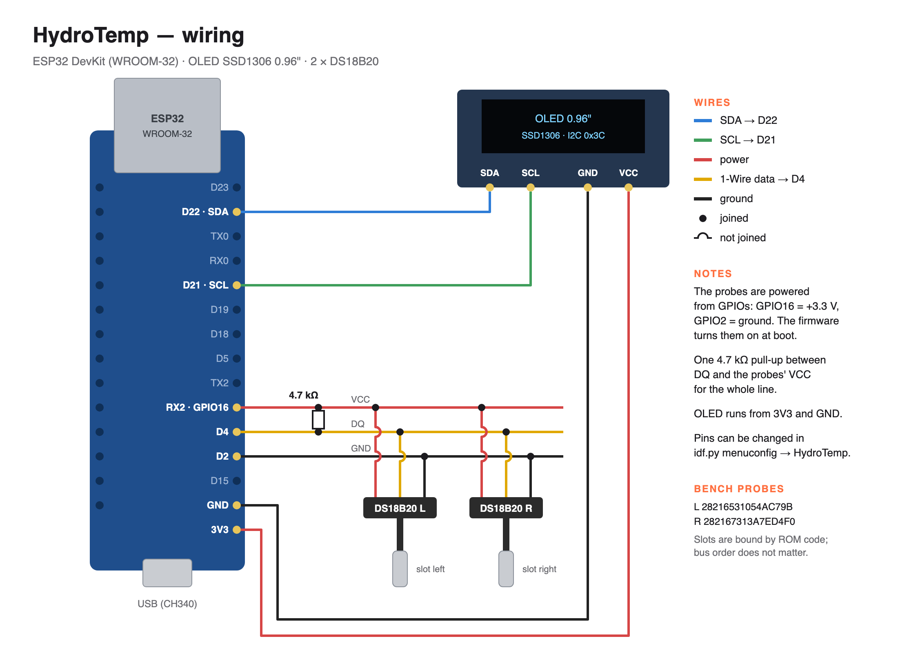

# HydroTemp

Water temperature monitor for a hydroponic setup. An ESP32 reads two
DS18B20 probes, shows both temperatures on a small OLED with a happy or
sad face, and serves a web page with 24-hour charts. It can also publish to MQTT,
with Home Assistant discovery.

## Hardware

- ESP32 board with a WROOM-32 module (4 MB flash).
- 0.96" SSD1306 OLED, I2C.
- Two DS18B20 probes and one 4.7 kΩ resistor.
- Optional: a printed case, STL files in `printing/`.



Pins can be changed in `idf.py menuconfig` → HydroTemp.

## Install a ready-made firmware

Open <https://grakovne.github.io/esp32-hydro-temp/> in Chrome or Edge,
plug the board in, press Install. Firmware files are also on the
[Releases](https://github.com/GrakovNe/esp32-hydro-temp/releases) page:
`hydrotemp.bin` is the full image for address 0x0.

## Build from source

You need ESP-IDF 5.5.

```bash
source ~/esp/esp-idf/export.sh
idf.py set-target esp32
idf.py build
idf.py -p /dev/cu.usbserial-XXXX flash monitor
```

Tests:

```bash
cd test/host && make test
node test/ui/ui_smoke.js
```

To publish a release, run the Release workflow on GitHub
(`gh workflow run release.yml`). It builds the firmware, attaches it to
a new release and updates the install page.

## Use

On first start the device creates a Wi-Fi network `HydroTemp-XXXX`; the
four characters are also on the screen. Connect to it from your phone,
pick your home Wi-Fi and save. After a restart the device is at
`http://hydrotemp-xxxx.local/` or at the address your router gave it.
Renaming the device in Settings changes the `.local` name too.

The web page has three tabs: Dashboard with current values and charts,
Settings, and Device Info.

### Sensors

The probes are called `left` and `right` by default; you can rename
them. The screen shows the first letter or digit of the name. Each probe has its
own allowed range, 18–23 °C by default: inside it the face smiles,
outside it frowns. A disconnected probe shows `--.-`.

The temperature is read every 5 minutes (configurable from 10 s to
1 h), the first time 5 s after power-on. Each probe is remembered by
its serial number and keeps its name after a reboot. A new probe takes
the place of a missing one.

Charts need the current time, so history starts once the device has
reached an internet time server.

### API

| Method | Path | |
| --- | --- | --- |
| GET | `/api/v1/current` | current readings |
| GET | `/api/v1/history` | last 24 hours |
| GET | `/api/v1/status` | device state |
| GET | `/api/v1/config` | settings |
| POST | `/api/v1/config` | change settings, the device restarts |
| GET | `/api/v1/wifi/scan` | visible Wi-Fi networks |
| POST | `/api/v1/reboot` | restart |
| POST | `/api/v1/factory-reset` | erase settings |

No password, so keep the device on a trusted network.

### MQTT

Turn MQTT on in Settings and enter the broker address. After every
reading the device sends one message per probe to
`esp32-hydro-temp/<id>/<name>` (name in lower case, spaces as `_`):

```json
{"temperature": 21.37, "out_of_range": false, "low": 18, "high": 23, "timestamp": 1761400000}
```

Home Assistant discovery is on by default: each probe shows up as a
temperature sensor plus an "out of range" alarm.

### Factory reset

Press the red button in Settings, or hold the BOOT button on the board
for 5 seconds. All settings and history are erased, and the device
starts its setup Wi-Fi again.

## License

MIT, see `LICENSE`.
